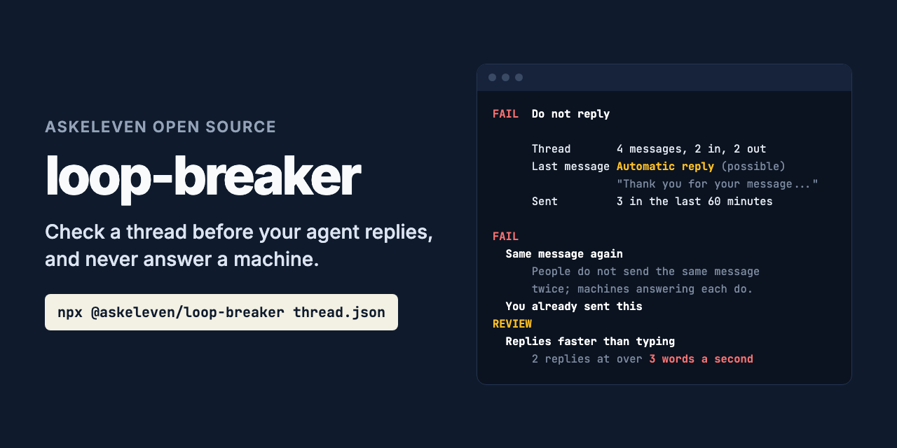

# loop-breaker



**Stop your agent replying to an autoresponder, a bounce, or another bot.**

```bash
npx @askeleven/loop-breaker thread.json --reply reply.txt
```

An agent that answers every message will answer an out-of-office. The out-of-office
answers back. So does the agent. Point two agents at each other, or one agent at a
helpdesk that acknowledges every email with a new ticket number, and they will talk all
night, politely, at your expense and in your name. Nothing errors. Every message is
accepted and delivered. loop-breaker is the check that runs before each reply: a CLI for
pipelines, an MCP server for agents, and a library for everything else. It returns a
verdict, the facts behind it, and the reason for every problem it finds.

Any channel: email, SMS, chat, webhooks. Zero dependencies. No signup, no account, no
network.

---

## What it checks

Before a reply, on the thread you pass in:

| Check | Verdict |
|---|---|
| **Automatic reply**: out-of-office, autoresponder, read receipt, "driving with Focus on" | Fail |
| **Delivery failure**: a bounce from the mail system | Fail |
| **Bulk or list mail**: List-Id, Precedence: bulk, "Reply STOP to opt out" | Fail |
| **No-reply sender**: `noreply@`, `notifications@`, `mailer-daemon@` | Fail |
| **They asked you to stop**: STOP, unsubscribe, "please stop emailing me" | Fail |
| **Same message again**: they sent the same words twice, give or take a ticket number | Fail |
| **Your message echoed back**: what you sent, returned to you | Fail |
| **You already sent this**: your reply repeats one you sent on the thread | Fail |
| **Too many messages** on the thread: default over 5 in 60 minutes | Fail |
| **Possibly an automatic reply**: "We've received your request; ticket #4821 has been created" | Review |
| **Replies faster than typing**: two or more replies that arrived at over 3 words a second | Review |

With the optional ledger, across every thread with the same counterparty:

| Check | Verdict |
|---|---|
| **They asked you to stop** on any thread or channel, at any time, until they write again | Fail |
| **Same message again**: word for word what they sent on another thread | Fail |
| **Nobody there is reading**: every reply from them in the last 7 days was automated | Fail |
| **Too many messages to them**: default over 10 in 24 hours, across threads | Fail |

**Keep** means nothing was found. **Review** means a person should decide. **Fail** means
do not reply.

### How it tells a person from a machine

Email headers decide it when they are there. `Auto-Submitted` (RFC 3834), `X-Autoreply`,
`Precedence`, `List-Id`, `X-Failed-Recipients`, a `multipart/report` body and a null
`Return-Path` are only set by software, so they are **certain**. So are senders such as
`mailer-daemon@` and `noreply@`.

Without headers, as on SMS and chat, it reads the words the sender wrote, not the quoted
message under them. "I am out of the office until Monday" is **likely** automated. "We've
received your request" is only **possible**, because people write that too, so it asks
for review rather than failing. "I'm out of office next week, can we start on the 10th?"
is a person, and is answered.

Then it watches how the other side behaves. People do not send the same message twice,
repeat yours back, or answer 60 words in two seconds. Machines do.

## What it does not do

**It does not send, delete or change anything.** It says whether to reply. The ledger only
grows when you record to it.

**It does not decide what to say instead.** When it fails a reply to an out-of-office, the
right move might be a follow-up after the return date. That is your agent's call, or a
person's.

**It does not read every language.** Headers work everywhere. The wording rules are
English, with out-of-office subject lines in French, German, Spanish, Italian and
Portuguese.

**It cannot see what it is not given.** A loop that runs across threads needs the ledger;
a reply that arrives seconds later needs times on the messages.

---

## Example

```
$ npx @askeleven/loop-breaker thread.json

FAIL  Do not reply

      Thread       4 messages, 2 in, 2 out
      Last message Automatic reply (possible)
                   "Thank you for your message. Our team will get back"
      Sent         3 in the last 60 minutes (limit 5)

FAIL
  Same message again
      The last message is the same as an earlier one from them, with at most
      a detail changed. People do not send the same message twice; machines
      answering each message do. Do not reply.
  You already sent this
      Your reply is the same as a message you already sent on this thread.
      Saying it again is the loop. Do not send it; if they have not
      answered, a person should decide what happens next.

REVIEW
  Possibly an automatic reply
      ...
  Replies faster than typing
      2 replies arrived faster than a person can type them, counting from
      your message before each (over 3 words a second). The other side is
      probably software. A person should look before this goes on.
```

One message on its own, such as a raw email, is classified:

```
$ npx @askeleven/loop-breaker reply.eml

AUTOMATED  Automatic reply, certain

      header   Auto-Submitted: auto-replied (automatic reply, certain)
      subject  Subject: Automatic reply: Your quote (automatic reply, likely)
      text     "I am out of the office until Monday 20 October with limited access" (automatic reply, likely)
```

## The thread

A JSON list of messages, oldest first, or an object with `messages`, and optionally
`reply` and `counterparty`:

```json
{
  "messages": [
    { "direction": "out", "at": "2026-10-16T14:40:00Z", "text": "Hi, following up on pricing." },
    { "direction": "in", "at": "2026-10-16T14:40:02Z", "raw": "From: ...\nAuto-Submitted: auto-replied\n\n..." }
  ],
  "reply": "Thanks for getting back to me!",
  "counterparty": "dana@acme.com"
}
```

Each message has `direction` (`in` from them, `out` from you) and any of `at` (ISO 8601
with an offset), `text`, `from`, `subject`, `headers`, or `raw`, a whole email, from which
the rest is read. Pass whatever your channel has: SMS needs only `direction`, `at` and
`text`. When every message has a time they are put in order; without times the timing
checks are skipped, and the result says so.

## Options

```
--reply <text|file>   The message you are about to send.
--ledger <file>       JSONL ledger, for checks across threads.
--counterparty <id>   Who the thread is with: an address, number or id.
--similarity <0-1>    Messages this alike count as the same. Default 0.85.
--max-sends <n>       Most messages you send on a thread within --window. Default 5.
--window <minutes>    Default 60.
--max-per-day <n>     Most messages to the counterparty in 24 hours. Default 10.
--now <time>          Check as of this time. Default now.
--json                Machine-readable output.
--no-colour           Plain text.
```

Exit code `0` means OK to reply, `1` means do not reply (it failed, or a person should
review it), `2` means it could not run. So it gates a pipeline:

```bash
npx @askeleven/loop-breaker thread.json --reply reply.txt && ./send reply.txt
```

## The ledger

A loop that opens a new thread every time, an autoresponse that arrives on five threads,
an opt-out sent by SMS to an agent that also emails: none of these are in the thread you
are replying to. The ledger is an append-only JSONL file with one line per message sent
or received, which every check can read.

```bash
npx @askeleven/loop-breaker record --ledger loops.jsonl --counterparty dana@acme.com --direction in reply.eml
npx @askeleven/loop-breaker record --ledger loops.jsonl --counterparty dana@acme.com --direction out
npx @askeleven/loop-breaker thread.json --ledger loops.jsonl --counterparty dana@acme.com
```

**It never stores what a message said.** A line holds who, when, which way, what kind of
message it was, whether it was an opt-out, an optional thread id, and a 16-character hash
of the normalized words, which is enough to spot the same message again and nothing more:

```json
{"ts":"2026-10-16T14:01:05.000Z","counterparty":"dana@acme.com","direction":"in","thread":"t1","fp":"9f2c41d07ab3e815","kind":"auto_reply"}
```

Each record is one append of one line, so several processes can share a ledger.

## For agents: MCP server

```bash
npx @askeleven/loop-breaker mcp --ledger loops.jsonl
```

It serves `check_thread` (the thread and your reply, with a `counterparty` for the ledger
checks) and `classify_message` (one message). With `--ledger` it also serves
`record_message`, and tells the model to record every message sent and received. The
server tells the model never to reply when the verdict is fail, to stop on every thread
after an opt-out, to show review reasons to a person, and not to reword a repeated reply
to get past the check: the loop is the problem, not the wording.

**Claude Code**

```bash
claude mcp add loop-breaker -- npx -y @askeleven/loop-breaker mcp --ledger ~/.loop-breaker.jsonl
```

**Claude Desktop, Cursor, and other clients** that take a JSON config:

```json
{
  "mcpServers": {
    "loop-breaker": {
      "command": "npx",
      "args": ["-y", "@askeleven/loop-breaker", "mcp", "--ledger", "/path/to/loops.jsonl"]
    }
  }
}
```

## As a library

```js
import { checkThread, readLedger, recordMessage } from '@askeleven/loop-breaker'

const { events } = await readLedger('loops.jsonl')
const result = checkThread(thread, { reply, counterparty: 'dana@acme.com', history: events })

if (result.verdict === 'keep') {
  await send(reply)
  await recordMessage('loops.jsonl', { counterparty: 'dana@acme.com', direction: 'out', message: reply })
}
```

`checkThread(messages, options)` takes `reply`, `counterparty`, `history`, `similarity`,
`maxSends`, `windowMinutes`, `wordsPerSecond`, `maxSendsPerDay`, `lookbackHours`, and `now`
(a clock, for tests). Every reason has a stable `code` (`auto_reply`, `bounce`, `opt_out`,
`repeated_inbound` and so on) to match on, and a `detail` to show a person.

`classifyMessage(message)` returns the `kind` (`person`, `auto_reply`, `bounce`, `bulk`,
`no_reply`), the `confidence`, whether it is an `optOut`, and the `signals` behind it.
`parseEmail(raw)`, `similarity(a, b)` and `isOptOut(text)` are exported too.

## Privacy

Nothing leaves your machine. There is no network code. The ledger holds no message text.

## Requirements

Node 20 or newer. No dependencies.

---

## Why we built it

[AskEleven](https://askeleven.com) runs AI employees that email and text candidates and
customers for small businesses. An agent that answers every message on its own needs to
know which messages were not written by anyone. This is that check, run before each
reply.

## Contributing

Issues and pull requests welcome, especially:

- **Autoresponders it misses**, with the headers and the text (anonymised). These matter
  most.
- **People it mistakes for machines.** A normal message a person sent that it fails.
- **Out-of-office wording** in other languages.
- **MCP clients** where the server does not work as documented.

Run the tests with `npm test`. They use a fixed clock and no network, so they are offline
and fast.

After a successful run in an interactive terminal, the CLI prints one line asking for a GitHub star, at most once a week. It never shows in CI, in `--json` output, in pipes or when running as an MCP server. Set `ASKELEVEN_NO_STAR=1` to turn it off.

## License

MIT. See [LICENSE](LICENSE).
